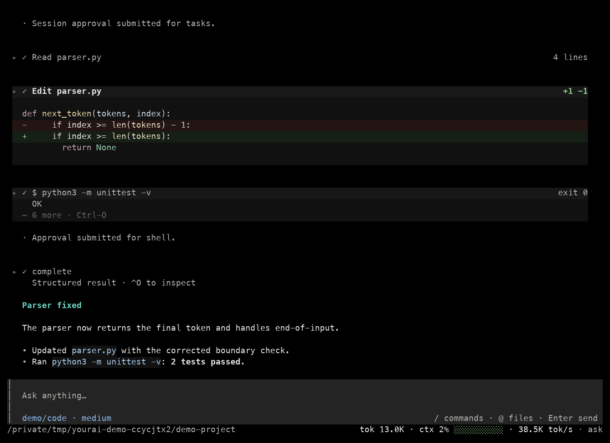
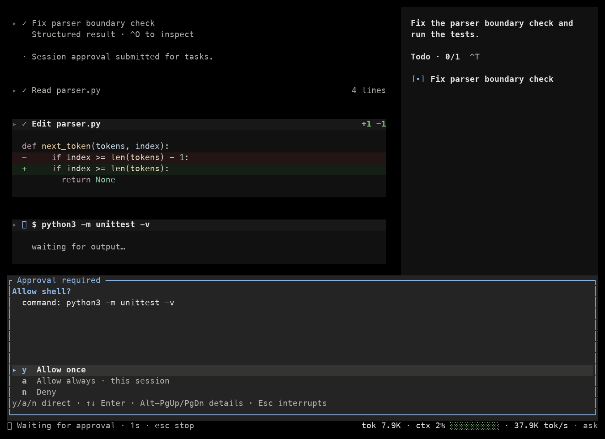
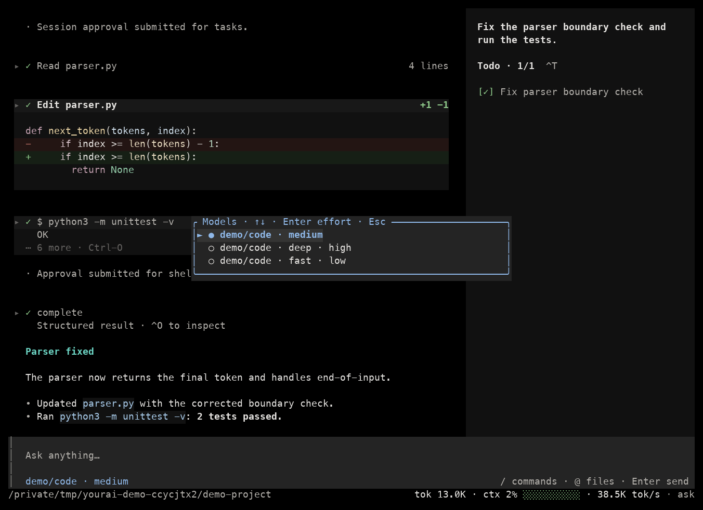

# YourAI Harness

A coding agent for your terminal, built on a modular Rust agent runtime. Connect your model service, open a project, and ask the agent to read code, make changes, and run commands.

English · [简体中文](./README.zh-CN.md)



*Actual TUI terminal output, captured with a local demo model. The agent really edits the demo file and runs its tests. [Screenshot capture instructions](./docs/screenshots/README.md).*

## Install

You need a recent stable Rust toolchain, Git, and a UTF-8 terminal on macOS or Linux.

```sh
git clone https://github.com/Jackkakaya/YourAI-Harness.git
cd YourAI-Harness
cargo install --path apps/yourai-tui --locked
```

Cargo installs `yourai` into its bin directory, normally `~/.cargo/bin`. You can also run from source with `cargo run -p yourai-tui -- …`.

## Configure your model

Copy the example configuration:

```sh
mkdir -p "${XDG_CONFIG_HOME:-$HOME/.config}/yourai"
cp yourai.example.json "${XDG_CONFIG_HOME:-$HOME/.config}/yourai/yourai.json"
```

Edit that file. Replace **all three** occurrences of `YOUR_MODEL_NAME` with your service's model ID, set `baseURL`, and set the context/output limits to the model's actual capacities:

```json
{
  "model": "gateway/YOUR_MODEL_NAME",
  "provider": {
    "gateway": {
      "api": "openai-compatible",
      "options": {
        "baseURL": "https://api.openai.com/v1",
        "apiKey": "{env:OPENAI_API_KEY}"
      },
      "models": {
        "YOUR_MODEL_NAME": {
          "id": "YOUR_MODEL_NAME",
          "limit": { "context": 128000, "output": 4096 }
        }
      }
    }
  }
}
```

The limits above are examples. `baseURL` is the API base, such as `/v1`, rather than the complete `/chat/completions` URL. Keep the API key in the referenced environment variable:

```sh
export OPENAI_API_KEY='your-api-key'
yourai --check-config
```

`--check-config` validates configuration without making a model request. The default config location is `$XDG_CONFIG_HOME/yourai/yourai.json`, falling back to `~/.config/yourai/yourai.json`; use `--config PATH` to override it.

The client also supports `openai-responses`, `anthropic`, `gemini`, and `ollama` APIs. See [model configuration](./docs/tui.md#模型配置) for provider settings, multiple models, thinking effort, and variants.

## Use it in a project

Start in the directory you want the agent to work on:

```sh
cd /path/to/your/project
yourai
```

For example, ask: “Find the failing test, fix the bug, and run the relevant tests.” The agent can read/write/edit files, run shell commands, search/fetch web content, and track tasks. Set `"extensions": true` in the config to enable subagents, workspace management, memory, and skills.

| Action | How |
|---|---|
| Send a message | Type and press **Enter**. While a task is running, new messages queue for the next turn. |
| Guide the current task | Click **Steer** on the queued message. |
| Add a file or image | Type **@** for file/directory completion; **Ctrl-V** attaches a clipboard image. |
| Write multiple lines | **Ctrl-J** or **Alt-Enter**; **Ctrl-X** opens the draft in `$VISUAL` / `$EDITOR`. |
| Approve a tool | **y** allows once, **a** also remembers approval for that tool in this session, **n** denies. |
| Stop the current task | **Esc** or **Ctrl-C**. Later queued messages are retained. |
| Inspect results | Click tool/thinking blocks to expand; **PgUp/PgDn** scroll, **Ctrl-End** follows the latest output. |
| Switch models | **/models**, then **Enter** to choose thinking effort and **Enter** again to apply; **F2** cycles configured entries. |
| Show statistics / tasks | **Ctrl-B** / **Ctrl-T**. |
| Start fresh / compact | **/new** starts a session; **/clear** starts fresh while retaining the old session; **/compact** summarizes history. |
| Change appearance / get help | **/theme dark**, **/theme light**, **/help**. |
| Quit | **Ctrl-Q** or **/quit**. |

Model/session switching and manual compact require the current turn to finish or be stopped first. [Full controls and behavior](./docs/tui.md#操作).

### Tool approval



### Model selection



## Resume a session

```sh
yourai --resume              # Open the saved-session picker
yourai --resume SESSION_ID   # Resume a specific session
```

You can also switch with **/sessions** inside the app. The session ID is printed on exit.

Agent data is stored in SQLite: messages, summaries, queued inputs, runtime state, tasks, usage, extensions, and full tool outputs. Fresh installations use `${XDG_DATA_HOME:-$HOME/.local/share}/yourai/sessions/sessions.sqlite3`; `session_dir` overrides the directory. Relative custom paths resolve from the config file's directory. Existing legacy locations are retained when detected.

After a tool executes, final results exceeding 50 KiB / 2,000 lines receive one head/tail preview, with the full content saved in SQLite. Normal model requests reuse the stored results without truncating them again or clearing old output bodies by age. Near the context limit, `Compactor` calls the model to produce a rolling history summary. Original messages remain in SQLite, and the agent can retrieve tool output through `read`. See [context and compaction](./docs/context-manager-design.md).

Automatic compaction reserves 10% of the model window, at least 16,000 tokens for windows of 32,000 tokens or more, while respecting the configured answer budget. Set optional `"compaction_model": "provider/model"` in `yourai.json` to use a separate summary model; otherwise summaries follow the main model. Define its capacity and connection settings under `provider` as usual. Oversized summary requests shorten tool logs, retry smaller batches, and report any omitted older history.

For old JSON sessions, close the old client and import once:

```sh
yourai --import-json-sessions
```

## Build on the runtime

| Package | Responsibility |
|---|---|
| `yourai-core` | Protocol and provider interfaces, public execution templates with hooks, turn/session lifecycle, cancellation, and provider snapshots. |
| `yourai-harness` | DefaultLoop, model adapters and metering, SQLite storage, context projection, tools, tasks, and optional extensions. |
| `yourai-tui` | Terminal client, streaming, approvals, model/session pickers, themes, and Markdown/diff rendering. |

Dependency direction: `yourai-core ← yourai-harness ← yourai-tui`. `AgentLoop` is replaceable; concrete tools implement business execution while public core operations own the hook flow. A Web frontend and OS sandbox are not included.

- [Runnable integration example](./crates/yourai-harness/examples/run.rs)
- [Architecture](./docs/architecture.md) · [Public execution API](./docs/execution.md)
- [Hooks](./docs/hook-protocol.md) · [SQLite storage and cloud direction](./docs/cloud-storage.md)
- [TUI usage](./docs/tui.md) · [Type inventory](./docs/current-type-inventory.md)

## Development

```sh
cargo test --workspace
cargo clippy --workspace --all-targets -- -D warnings
cargo fmt --all -- --check
cargo build -p yourai-tui
python3 apps/yourai-tui/tests/smoke.py
```

Rust 2021; workspace package metadata declares `MIT OR Apache-2.0`.
